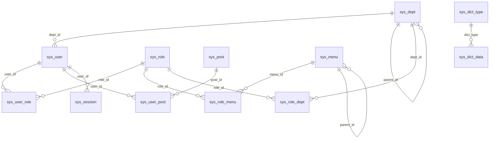

**file**: docs/requirements/requirement-database.md
**Status**: Active (Version 2.0.2)
**Area**: domain
**Key**: `requirement-database`
**Philosophy**: CIAO **v2.10.2** / CIAO-Lite (Caution • Intentional • Anti-fragile • Over-engineered / Over-protect)

## 1. Purpose

RustRbac stores its RBAC tables in sqlite3 or in MariaDB or MySQL. The default engine is sqlite3. The sqlite file is `rust_rbac.sqlite3`, mode `0600`, in the home directory `~/.local/RustRbac` (mode `0700`). mysql uses the database named by `RUSTRBAC_DB_NAME`. The product mysql database is `rust_rbac`. mysql tests use `rust_rbac_test`. MySQL users are `rust_rbac`@localhost and `rust_rbac`@127.0.0.1, granted only on `rust_rbac.*` and `rust_rbac_test.*`. The product **MUST NOT** open or write `pyrbac`, `pyrbac_test`, `ruoyi`, `ruoyi_db`, or `ry`.

`user_name` is the login, and there is no password salt column. The password column is `VARCHAR(255)`. The stored scheme is `pbkdf2_sha256` with 260000 iterations. Online sessions are `sys_session`. This product does not use Redis. The writer is the Rust store (`rusqlite` and the `mysql` crate).

This file is the structure. Who may see a department, and which menu string allows an action, stay on `requirement-rbac`.

### 1.1 Human-facing

**In one sentence:** A run that needs the database creates these tables when they are missing and fills them only when no user exists yet. The default store is the sqlite3 file. `rust-rbac db-init` prints `Database {label}: seeded.` or `Database {label}: present.`

| Box | Meaning | Example |
|-----|---------|---------|
| You / this login | The operator | `rust-rbac` on a terminal, or `rust-rbac db-init` |
| The other role | `rust_rbac`@localhost and `rust_rbac`@127.0.0.1 | Granted only on `rust_rbac.*` and `rust_rbac_test.*` |
| Not this file | Which departments a user may see | `requirement-rbac` |

| Includes | Excludes |
|----------|----------|
| The columns, keys, and join columns in section 1.2 | A foreign-key constraint |
| `?` placeholders through the Rust store (`rusqlite` and the `mysql` crate) | String-built SQL from a typed name |
| Choice 1 sqlite3, including the default file, and choice 2 mysql | A third database engine |
| Create-if-missing, then seed-if-empty | A second seed that duplicates admin |
| `sys_session` for online users | Redis |
| Refusal of `pyrbac`, `pyrbac_test`, `ruoyi`, `ruoyi_db`, and `ry` | Opening or writing those names |

### 1.2 Structure

`db-init` creates each table with `CREATE TABLE IF NOT EXISTS`. An existing table is left as it is. On mysql, every table uses `ENGINE=InnoDB` and `DEFAULT CHARSET=utf8mb4`. On sqlite3, the same columns and keys are created without an engine clause and without a charset clause. An `AUTO_INCREMENT` key is `INTEGER PRIMARY KEY AUTOINCREMENT` on sqlite3. No statement declares a `FOREIGN KEY`. The lines in the diagram are the columns the queries join.

A repeated `status` of `'0'` means normal. A user status of `'1'` means disabled. A `del_flag` of `'0'` means the row is listed. A `del_flag` of `'2'` means it was removed. `sys_menu` has no `del_flag`. Its `status` is the on/off column. `data_scope` is stored here. The meaning of 1, 2, 3, and 4 is `requirement-rbac`.

`sys_oper_log` stores `dept_name` as text. `sys_logininfor` stores `user_name` as text. Neither log table points at an id.

#### Departments, accounts, posts, roles, and menus

`sys_dept` — one department. `parent_id` 0 is the root. `ancestors` is the comma-separated path of parent ids.

| Column | Type | Key / default |
|--------|------|----------------|
| dept_id | BIGINT NOT NULL AUTO_INCREMENT | PRIMARY KEY |
| parent_id | BIGINT NOT NULL | default 0 |
| ancestors | VARCHAR(50) NOT NULL | default `''` |
| dept_name | VARCHAR(30) NOT NULL | default `''` |
| order_num | INT NOT NULL | default 0 |
| leader | VARCHAR(20) | NULL |
| phone | VARCHAR(11) | NULL |
| email | VARCHAR(50) | NULL |
| status | CHAR(1) NOT NULL | default `'0'` |
| del_flag | CHAR(1) NOT NULL | default `'0'` |
| create_by | VARCHAR(64) NOT NULL | default `''` |
| create_time | DATETIME | NULL |
| update_by | VARCHAR(64) NOT NULL | default `''` |
| update_time | DATETIME | NULL |

`sys_user` — one account. `user_name` is the login. `password` is `VARCHAR(255)` and holds `pbkdf2_sha256` with 260000 iterations. There is no salt column. The salt travels inside the stored string.

| Column | Type | Key / default |
|--------|------|----------------|
| user_id | BIGINT NOT NULL AUTO_INCREMENT | PRIMARY KEY |
| dept_id | BIGINT | NULL |
| user_name | VARCHAR(30) NOT NULL | UNIQUE `uk_sys_user_name` |
| nick_name | VARCHAR(30) NOT NULL | |
| user_type | VARCHAR(2) NOT NULL | default `'00'` |
| email | VARCHAR(50) NOT NULL | default `''` |
| phonenumber | VARCHAR(11) NOT NULL | default `''` |
| sex | CHAR(1) NOT NULL | default `'2'` |
| avatar | VARCHAR(100) NOT NULL | default `''` |
| password | VARCHAR(255) NOT NULL | default `''` |
| status | CHAR(1) NOT NULL | default `'0'` |
| del_flag | CHAR(1) NOT NULL | default `'0'` |
| login_ip | VARCHAR(128) NOT NULL | default `''` |
| login_date | DATETIME | NULL |
| pwd_update_date | DATETIME | NULL |
| create_by | VARCHAR(64) NOT NULL | default `''` |
| create_time | DATETIME | NULL |
| update_by | VARCHAR(64) NOT NULL | default `''` |
| update_time | DATETIME | NULL |
| remark | VARCHAR(500) | NULL |

`sys_post` — a job title. It does not grant a permission.

| Column | Type | Key / default |
|--------|------|----------------|
| post_id | BIGINT NOT NULL AUTO_INCREMENT | PRIMARY KEY |
| post_code | VARCHAR(64) NOT NULL | UNIQUE `uk_sys_post_code` |
| post_name | VARCHAR(50) NOT NULL | |
| post_sort | INT NOT NULL | no default |
| status | CHAR(1) NOT NULL | default `'0'` |
| create_by | VARCHAR(64) NOT NULL | default `''` |
| create_time | DATETIME | NULL |
| update_by | VARCHAR(64) NOT NULL | default `''` |
| update_time | DATETIME | NULL |
| remark | VARCHAR(500) | NULL |

`sys_role` — `role_key` is unique. `data_scope` is one character. `status` has no default, so an insert must supply it.

| Column | Type | Key / default |
|--------|------|----------------|
| role_id | BIGINT NOT NULL AUTO_INCREMENT | PRIMARY KEY |
| role_name | VARCHAR(30) NOT NULL | |
| role_key | VARCHAR(100) NOT NULL | UNIQUE `uk_sys_role_key` |
| role_sort | INT NOT NULL | no default |
| data_scope | CHAR(1) NOT NULL | default `'1'` |
| menu_check_strictly | TINYINT NOT NULL | default 1 |
| dept_check_strictly | TINYINT NOT NULL | default 1 |
| status | CHAR(1) NOT NULL | no default |
| del_flag | CHAR(1) NOT NULL | default `'0'` |
| create_by | VARCHAR(64) NOT NULL | default `''` |
| create_time | DATETIME | NULL |
| update_by | VARCHAR(64) NOT NULL | default `''` |
| update_time | DATETIME | NULL |
| remark | VARCHAR(500) | NULL |

`sys_menu` — `parent_id` 0 is a top menu. `perms` is the permission string. The seed uses `menu_type` `M` for a directory, `C` for a menu, and `F` for a button.

| Column | Type | Key / default |
|--------|------|----------------|
| menu_id | BIGINT NOT NULL AUTO_INCREMENT | PRIMARY KEY |
| menu_name | VARCHAR(50) NOT NULL | |
| parent_id | BIGINT NOT NULL | default 0 |
| order_num | INT NOT NULL | default 0 |
| path | VARCHAR(200) NOT NULL | default `''` |
| component | VARCHAR(255) | NULL |
| query | VARCHAR(255) | NULL |
| route_name | VARCHAR(50) NOT NULL | default `''` |
| is_frame | INT NOT NULL | default 1 |
| is_cache | INT NOT NULL | default 0 |
| menu_type | CHAR(1) NOT NULL | default `''` |
| visible | CHAR(1) NOT NULL | default `'0'` |
| status | CHAR(1) NOT NULL | default `'0'` |
| perms | VARCHAR(100) | NULL |
| icon | VARCHAR(100) NOT NULL | default `'#'` |
| create_by | VARCHAR(64) NOT NULL | default `''` |
| create_time | DATETIME | NULL |
| update_by | VARCHAR(64) NOT NULL | default `''` |
| update_time | DATETIME | NULL |
| remark | VARCHAR(500) NOT NULL | default `''` |

#### Link tables

Each link table is only the two ids. The pair is the primary key.

| Table | Columns | Primary key |
|-------|---------|-------------|
| sys_user_role | user_id BIGINT NOT NULL, role_id BIGINT NOT NULL | (user_id, role_id) |
| sys_user_post | user_id BIGINT NOT NULL, post_id BIGINT NOT NULL | (user_id, post_id) |
| sys_role_menu | role_id BIGINT NOT NULL, menu_id BIGINT NOT NULL | (role_id, menu_id) |
| sys_role_dept | role_id BIGINT NOT NULL, dept_id BIGINT NOT NULL | (role_id, dept_id) |

`sys_role_dept` is the department list for data scope 2. The other scopes do not read it.

#### Parameters, dictionaries, and notices

`sys_config` — one parameter. `config_key` is unique.

| Column | Type | Key / default |
|--------|------|----------------|
| config_id | INT NOT NULL AUTO_INCREMENT | PRIMARY KEY |
| config_name | VARCHAR(100) NOT NULL | default `''` |
| config_key | VARCHAR(100) NOT NULL | UNIQUE `uk_sys_config_key`, default `''` |
| config_value | VARCHAR(500) NOT NULL | default `''` |
| config_type | CHAR(1) NOT NULL | default `'N'` |
| create_by | VARCHAR(64) NOT NULL | default `''` |
| create_time | DATETIME | NULL |
| update_by | VARCHAR(64) NOT NULL | default `''` |
| update_time | DATETIME | NULL |
| remark | VARCHAR(500) | NULL |

`sys_dict_type` — one dictionary name. `dict_type` is unique.

| Column | Type | Key / default |
|--------|------|----------------|
| dict_id | BIGINT NOT NULL AUTO_INCREMENT | PRIMARY KEY |
| dict_name | VARCHAR(100) NOT NULL | default `''` |
| dict_type | VARCHAR(100) NOT NULL | UNIQUE `uk_sys_dict_type`, default `''` |
| status | CHAR(1) NOT NULL | default `'0'` |
| create_by | VARCHAR(64) NOT NULL | default `''` |
| create_time | DATETIME | NULL |
| update_by | VARCHAR(64) NOT NULL | default `''` |
| update_time | DATETIME | NULL |
| remark | VARCHAR(500) | NULL |

`sys_dict_data` — one label inside a dictionary. `dict_type` matches `sys_dict_type.dict_type`. It is not `dict_id`.

| Column | Type | Key / default |
|--------|------|----------------|
| dict_code | BIGINT NOT NULL AUTO_INCREMENT | PRIMARY KEY |
| dict_sort | INT NOT NULL | default 0 |
| dict_label | VARCHAR(100) NOT NULL | default `''` |
| dict_value | VARCHAR(100) NOT NULL | default `''` |
| dict_type | VARCHAR(100) NOT NULL | default `''` |
| css_class | VARCHAR(100) | NULL |
| list_class | VARCHAR(100) | NULL |
| is_default | CHAR(1) NOT NULL | default `'N'` |
| status | CHAR(1) NOT NULL | default `'0'` |
| create_by | VARCHAR(64) NOT NULL | default `''` |
| create_time | DATETIME | NULL |
| update_by | VARCHAR(64) NOT NULL | default `''` |
| update_time | DATETIME | NULL |
| remark | VARCHAR(500) | NULL |

`sys_notice` — one notice. `notice_title` and `notice_type` have no default.

| Column | Type | Key / default |
|--------|------|----------------|
| notice_id | INT NOT NULL AUTO_INCREMENT | PRIMARY KEY |
| notice_title | VARCHAR(50) NOT NULL | no default |
| notice_type | CHAR(1) NOT NULL | no default |
| notice_content | TEXT | NULL |
| status | CHAR(1) NOT NULL | default `'0'` |
| create_by | VARCHAR(64) NOT NULL | default `''` |
| create_time | DATETIME | NULL |
| update_by | VARCHAR(64) NOT NULL | default `''` |
| update_time | DATETIME | NULL |
| remark | VARCHAR(255) | NULL |

#### Logs and sessions

`sys_oper_log` — one mutation. `business_type` 1 is add, 2 is edit, and 3 is remove. `oper_param` is at most 2000 characters and is not a password.

| Column | Type | Key / default |
|--------|------|----------------|
| oper_id | BIGINT NOT NULL AUTO_INCREMENT | PRIMARY KEY |
| title | VARCHAR(50) NOT NULL | default `''` |
| business_type | INT NOT NULL | default 0 |
| method | VARCHAR(100) NOT NULL | default `''` |
| request_method | VARCHAR(10) NOT NULL | default `''` |
| operator_type | INT NOT NULL | default 1 |
| oper_name | VARCHAR(50) NOT NULL | default `''` |
| dept_name | VARCHAR(50) NOT NULL | default `''` |
| oper_url | VARCHAR(255) NOT NULL | default `''` |
| oper_ip | VARCHAR(128) NOT NULL | default `''` |
| oper_location | VARCHAR(255) NOT NULL | default `''` |
| oper_param | VARCHAR(2000) NOT NULL | default `''` |
| json_result | VARCHAR(2000) NOT NULL | default `''` |
| status | INT NOT NULL | default 0 |
| error_msg | VARCHAR(2000) NOT NULL | default `''` |
| oper_time | DATETIME | NULL |
| cost_time | BIGINT NOT NULL | default 0 |

`sys_logininfor` — one login attempt. `status` `'0'` succeeded. `status` `'1'` failed.

| Column | Type | Key / default |
|--------|------|----------------|
| info_id | BIGINT NOT NULL AUTO_INCREMENT | PRIMARY KEY |
| user_name | VARCHAR(50) NOT NULL | default `''` |
| ipaddr | VARCHAR(128) NOT NULL | default `''` |
| login_location | VARCHAR(255) NOT NULL | default `''` |
| browser | VARCHAR(50) NOT NULL | default `''` |
| os | VARCHAR(50) NOT NULL | default `''` |
| status | CHAR(1) NOT NULL | default `'0'` |
| msg | VARCHAR(255) NOT NULL | default `''` |
| login_time | DATETIME | NULL |

`sys_session` — one signed-in token. The token is the primary key.

| Column | Type | Key / default |
|--------|------|----------------|
| token | VARCHAR(80) NOT NULL | PRIMARY KEY |
| user_id | BIGINT NOT NULL | KEY `idx_sys_session_user` |
| user_name | VARCHAR(30) NOT NULL | |
| ipaddr | VARCHAR(128) NOT NULL | default `''` |
| user_agent | VARCHAR(200) NOT NULL | default `''` |
| csrf | VARCHAR(80) NOT NULL | no default |
| surface | VARCHAR(16) NOT NULL | no default |
| login_time | DATETIME NOT NULL | no default |
| last_access | DATETIME NOT NULL | no default |

## 2. Normative rules

1. **Engine.** The engine **MUST** be `sqlite3` or `mysql`. An empty `RUSTRBAC_DB_ENGINE` **MUST** mean sqlite3. Choice 1 is sqlite3. Choice 2 is mysql. The sqlite3 file **MUST** default to `rust_rbac.sqlite3` in `~/.local/RustRbac` from `requirement-environment`. `RUSTRBAC_SQLITE_FILE` **MUST** replace that path when it is set. mysql **MUST** use the database named by `RUSTRBAC_DB_NAME`. The default name is `rust_rbac`. mysql tests **MUST** set `rust_rbac_test`. The product **MUST NOT** open or write `pyrbac`, `pyrbac_test`, `ruoyi`, `ruoyi_db`, or `ry`.
2. **Privilege.** The MySQL users `rust_rbac`@localhost and `rust_rbac`@127.0.0.1 **MUST** be granted only on `rust_rbac.*` and `rust_rbac_test.*`. The grants **MUST** stay within `SELECT`, `INSERT`, `UPDATE`, `DELETE`, `CREATE`, `DROP`, `INDEX`, and `ALTER`. The sqlite3 file **MUST** be mode `0600`. The home directory **MUST** be mode `0700`. A password **MUST** be required for mysql and **MUST NOT** be required for sqlite3. There is no password default.
3. **Statements.** The writer **MUST** be the Rust store (`rusqlite` and the `mysql` crate). Every value **MUST** be a `?` placeholder. `FIND_IN_SET` and `NOW()` **MUST** be rewritten only for sqlite. An error returned to the operator **MUST NOT** include the SQL text or the password.
4. **Tables.** `db-init` **MUST** create `sys_dept`, `sys_user`, `sys_post`, `sys_role`, `sys_menu`, `sys_user_role`, `sys_role_menu`, `sys_role_dept`, `sys_user_post`, `sys_oper_log`, `sys_dict_type`, `sys_dict_data`, `sys_config`, `sys_logininfor`, `sys_notice`, and `sys_session` when they are missing.
5. **Shape.** A mysql table created by `db-init` **MUST** use InnoDB and `utf8mb4` and **MUST** have the columns and keys in section 1.2. A sqlite3 table **MUST** have those columns and keys, with `INTEGER PRIMARY KEY AUTOINCREMENT` where section 1.2 says `AUTO_INCREMENT`, and **MUST NOT** declare an engine or a charset. `db-init` **MUST NOT** declare a foreign key. `db-init` **MUST NOT** change a table that already exists.
6. **Seed once.** When `sys_user` has any row, `db-init` **MUST** print `Database {label}: present.` and **MUST NOT** insert another admin. The first empty run **MUST** print `Database {label}: seeded.` For sqlite, `{label}` **MUST** be the file path. For mysql, `{label}` **MUST** be the database name.
7. **Automatic init.** The text menu, `serve`, and every domain verb **MUST** call the same init as `db-init` when the tables are missing or `sys_user` is empty. On the text menu that call **MUST** happen before the saved sign-in is tried and before any account question. That path uses the current engine. The default is the sqlite3 file. It **MUST NOT** ask for an engine. On a domain verb it **MUST** happen before the verb body. A later call **MUST** print `Database {label}: present.` and **MUST NOT** insert another administrator. `help`, `version`, `about`, `db-engine`, and the self-management verbs **MUST NOT** open the database. A connection failure **MUST** still name the settings to check. `db-init` **MUST** remain and **MUST** print `Database {label}: seeded.` or `Database {label}: present.`
8. **Choice.** The command `db-engine`, setup row 218, the web sign-in page, and the signed-in Database page **MUST** each offer choice 1 sqlite3, including the default file path, and choice 2 mysql. An empty choice **MUST** keep the current engine. The environment **MUST** win over the mode-0600 file. A web sign-in from a non-loopback address **MUST NOT** switch the engine. `RUSTRBAC_ALLOW_REMOTE` is environment-only and is not a database setting. The text menu before sign-in does not offer that choice. The saved sign-in is `requirement-local-login`.

## 3. Acceptance checks

| ID | Check |
|----|-------|
| AC-1 | The first `db-init` on an empty sqlite3 file prints `Database {path}: seeded.` |
| AC-2 | The second `db-init` prints `Database {path}: present.` |
| AC-3 | A failed statement does not echo the password |
| AC-4 | A domain verb on a database with no tables seeds once, then continues |
| AC-5 | Choice 1 selects the default sqlite3 file and choice 2 selects mysql |
| AC-6 | The sqlite3 file is mode 0600 and the home directory is mode 0700 |
| AC-7 | Opening `pyrbac`, `pyrbac_test`, `ruoyi`, `ruoyi_db`, or `ry` is refused |

## Terminologies

| Term | Meaning in this file |
|------|----------------------|
| Product database | sqlite3 file `rust_rbac.sqlite3`, or the mysql schema named `rust_rbac` unless `RUSTRBAC_DB_NAME` says otherwise |
| Default file | `rust_rbac.sqlite3` in `~/.local/RustRbac` when `RUSTRBAC_SQLITE_FILE` is empty |
| Test database | A temporary sqlite3 file, or mysql `rust_rbac_test` when that engine is under test |
| Denied name | `pyrbac`, `pyrbac_test`, `ruoyi`, `ruoyi_db`, or `ry`. The product does not open or write them |
| Seed | The first English rows inserted only into an empty `sys_user` |
| Seed message | `Database {label}: seeded.` or `Database {label}: present.` |
| Link table | A two-column table whose pair of ids is the primary key |
| Structure | The columns, keys, engine, and charset in section 1.2 |

## 7. Status history

| Date | Status | Note |
|------|--------|------|
| 2026-10-11 | Active 1.0.0 | Dedicated MariaDB schemas and FastAPI-shaped tables |
| 2026-10-11 | Active 1.1.0 | Column lists, keys, and the join diagram |
| 2026-10-11 | Active 1.2.0 | A menu, serve, or domain verb initializes a missing database |
| 2026-10-11 | Active 1.3.0 | sqlite3 default file and mysql. The same choice on the command, the menu, and the web page |
| 2026-10-11 | Active 1.3.0 | The table text names this product only |
| 2026-10-11 | Active 2.0.0 | RustRbac, `rust_rbac`, `RUSTRBAC_*`. Denied names include `pyrbac`. Rust store. Seed message names the label |
| 2026-10-11 | Active 2.0.1 | The text menu uses the current engine and does not ask for one before sign-in |
| 2026-10-14 | Active 2.0.2 | The menu engine choice is setup row 218 |

---

**Last Updated**: 2026-10-14
**Owner**: project maintainers
**Alignment**: Registry `docs/requirements/index.md`; **CIAO** (https://github.com/cloudgen/ciao); CIAO-Lite (https://github.com/cloudgen/ciao-lite).
