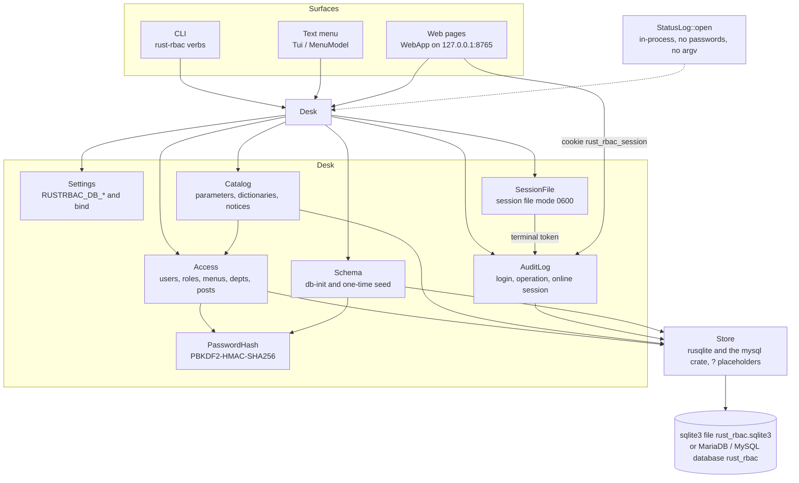
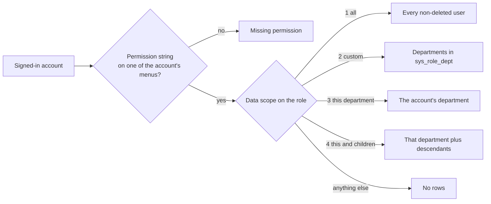
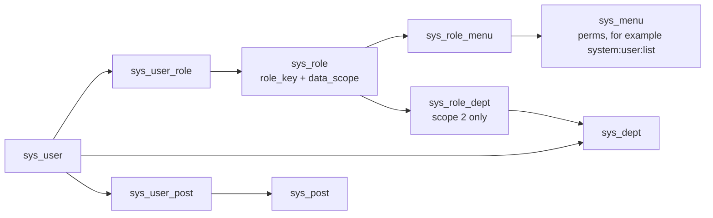

**file**: docs/requirements/requirement-rbac.md
**Status**: Active (Version 1.3.3)
**Area**: domain
**Key**: `requirement-rbac`
**Philosophy**: CIAO **v2.10.2** / CIAO-Lite (Caution • Intentional • Anti-fragile • Over-engineered / Over-protect)

## 1. Purpose

This file is the RBAC system. It stands on its own: the path from a surface to a row, the permission check, the data scope, the records, the seed, and the protected rows. A signed-in account may do an action only when one of its menus carries that permission string, or when a role key is `admin`. A user list shows only the departments the account's roles allow.

The scope numbers are 1 all, 2 custom departments, 3 this department, and 4 this department and children. Scope 5 is not granted. An unknown scope contributes no rows.

Bind names, cookie flags, and `CREATE TABLE` text stay on their peer files. This file still names those boxes so the map can be read here.

### 1.1 Human-facing

**In one sentence:** An administrator sees every account, a department operator sees that department, and a lead also sees child departments.

| Box | Meaning | Example |
|-----|---------|---------|
| You / this login | The account in the session file or the web cookie | `operator` |
| The other role | A permission string on a menu | `system:user:list` |
| Not this file | How the page is drawn | `requirement-web-interface` |

| Includes | Excludes |
|----------|----------|
| The system map, permission strings, and data scope 1–4 | A scope that means "only my own row" |
| Protected administrator user and role | Deleting user 1 or narrowing role 1 |
| Seeded admin, operator, clerk, and lead | A bcrypt password hash |

| Surface | What you open | What for |
|---------|---------------|----------|
| Text menu | `rust-rbac` on a terminal | The same user, role, and setup actions |
| Typed verb | `rust-rbac user-list` | That list without opening the menu |
| Web page | the URL printed by `serve` | That list, with the session cookie |

### 1.2 System map

The text menu, the typed commands, and the local web pages call one service, `Desk`. `Desk` builds the settings, the terminal session file, the database store, the audit log, the password hash, `Access`, and `Catalog`. `WebApp` is created only when serve is chosen. `WebApp` calls the same `Access` and `Catalog` methods. It does not keep a second permission list.

The terminal token is the mode-0600 file `session` under the application home (`~/.local/RustRbac` unless `RUSTRBAC_HOME` is set). The web token is the cookie `rust_rbac_session`. Both tokens are rows in `sys_session`. A file that is not mode `0600` is treated as signed out. The path and the bind rules are `requirement-environment`. The cookie flags are `requirement-web-interface`. The saved sign-in files are `requirement-local-login`. Those files are not the web cookie.

`StatusLog::open` in `src/main.rs` writes the status file. The logger is in-process. It is not ChronicleLogger. It is not `sys_oper_log`, and it does not store a password or argv. The construct is `requirement-rust-logging`. The ship language is Rust. The binary is `rust-rbac`. The product version is 1.1.1.



### 1.3 Permission check and data scope

A signed-in account reaches a user row only after both checks pass. `role_key` `admin` skips both and sees every non-deleted user. Any other account is refused when the permission string is absent. The refusal starts with `Missing permission`.



Scope 4 matches the account's department and departments whose `ancestors` contain that department id. Scope 2 matches only the departments linked on `sys_role_dept`. When no role contributes a matching scope, the list is empty.

### 1.4 Records

A permission string is `sys_menu.perms`. The account reaches it through its roles. Data scope is `sys_role.data_scope`. Posts name a job. They do not grant a permission string and they do not widen data scope. The menu list, the menu add, and the page actions edit, remove, and save sort are `requirement-rbac-menu`.



Login attempts, successful and failed, are `sys_logininfor`. A mutation is `sys_oper_log`. The online token is `sys_session`. The table list is `requirement-database`.

### 1.5 Seeded organization

`db-init` inserts these rows only when `sys_user` is empty. A later run reports `present` and does not add another administrator.

```text
Group (100)
├── Engineering (101)     admin, lead
│   └── Platform (103)    clerk
└── Operations (102)      operator
```

| Account | Department | Role | Role key | Scope | What a user list shows |
|---------|------------|------|----------|-------|------------------------|
| admin | Engineering (101) | Super administrator | admin | 1 all | Every account. The role also bypasses every permission check. |
| operator | Operations (102) | Common | common | 3 this department | Operations only |
| clerk | Platform (103) | Common | common | 3 this department | Platform only |
| lead | Engineering (101) | Lead | lead | 4 this department and children | Engineering and Platform |

Common menus are system, user list, user query, setup, parameter list, notice list, audit, operation log, and login log. They do not include user add, parameter edit, or force logout. Lead menus are system, user list, and user query. The administrator role receives every seeded menu.

## 2. Normative rules

1. **Admin bypass.** A role whose `role_key` is `admin` **MUST** pass every permission check and **MUST** see every non-deleted user.
2. **Permission fail closed.** Any other account **MUST** be refused when the permission string is absent. The refusal **MUST** start with `Missing permission`.
3. **Data scope.** User lists **MUST** apply scope 1 as all rows, scope 2 as the role's department list, scope 3 as the actor's department, and scope 4 as that department plus departments whose ancestors contain it. Any other scope **MUST** add no rows. No matching scope **MUST** show no users.
4. **Names.** A new `user_name` **MUST** match `^[A-Za-z][A-Za-z0-9_]{2,29}$`.
5. **Passwords.** Stored passwords **MUST** use `pbkdf2_sha256$iterations$salt$hash` with 260000 iterations. There is no salt column. Comparison **MUST** walk every digest byte and **MUST NOT** stop at the first difference. An unknown account **MUST** still run a dummy verify. The product **MUST NOT** log a password or argv. An unknown account or a wrong password **MUST** be `Unknown account or wrong password.` A signed-out action **MUST** be `Not signed in.` `whoami` for `role_key` `admin` **MUST** contain `admin=yes`.
6. **Protected rows.** User 1 **MUST NOT** be removed or disabled. Role 1 **MUST NOT** be granted a different scope or menu set through `role-grant`. The signed-in account **MUST NOT** remove itself.
7. **Seed.** When `sys_user` is empty, the init used by `db-init` and by a menu, serve, or domain verb **MUST** create admin (department 101, role admin, password `admin123`), operator (department 102, role common, scope 3, password `operator123`), clerk (department 103, role common, password `clerk123`), and lead (department 101, role lead, scope 4, password `lead123`). Common menus include user list and query, parameter list, notice list, operation log, and login log. They **MUST NOT** include user add, parameter edit, or force logout. Lead menus are system, user list, and user query.
8. **Audit.** A failed and a successful login **MUST** write `sys_logininfor`. A mutation **MUST** write `sys_oper_log`. The operation parameter **MUST NOT** be a password.
9. **One path.** The text menu, a typed verb, and a web page for the same action **MUST** call the same `Access` or `Catalog` method. The permission check **MUST** be `Access.require`. A surface **MUST NOT** keep a second allow-list.
10. **Session token.** The terminal session file and the web cookie **MUST** name a `sys_session` row. A missing user, a disabled user, or a token with no row **MUST** be treated as signed out.

## 3. Acceptance checks

| ID | Check |
|----|-------|
| AC-1 | Operator user-list returns only `operator` |
| AC-2 | Lead user-list returns `admin`, `clerk`, and `lead` |
| AC-3 | Scope 5 on the common role returns no users |
| AC-4 | Operator user-add and config-set fail with Missing permission |
| AC-5 | user-remove 1, disabling user 1, and role-grant on role 1 fail |

## Terminologies

| Term | Meaning in this file |
|------|----------------------|
| System map | Sections 1.2 through 1.5: surfaces, Desk, the two checks, the records, and the seed |
| Permission string | A menu `perms` value such as `system:user:add` |
| Data scope | The `data_scope` column: 1, 2, 3, or 4 |
| Protected user | `user_id` 1 |
| Protected role | `role_id` 1, role key `admin` |
| Soft delete | `del_flag` 2. Listed users have `del_flag` 0 |
| Surface | The text menu, a typed verb, or the web page |

## 7. Status history

| Date | Status | Note |
|------|--------|------|
| 2026-10-11 | Active 1.0.0 | Permissions, scope 1–4, seed, and protected rows |
| 2026-10-11 | Active 1.1.0 | System map, records, seeded organization, one permission path |
| 2026-10-11 | Active 1.2.0 | The same seed runs when a menu, serve, or domain verb finds an empty database |
| 2026-10-11 | Active 1.3.0 | Scope numbers and password storage are stated for this product |
| 2026-10-11 | Active 1.3.1 | Product RustRbac 1.1.0. Binary `rust-rbac`. Prefix `RUSTRBAC_`. Rust store. `StatusLog::open` |
| 2026-10-11 | Active 1.3.2 | Saved terminal sign-in points at `requirement-local-login` and is not the web cookie |
| 2026-10-15 | Active 1.3.3 | Menu records point at `requirement-rbac-menu` |

---

**Last Updated**: 2026-10-15
**Owner**: project maintainers
**Alignment**: Registry `docs/requirements/index.md`; **CIAO** (https://github.com/cloudgen/ciao); CIAO-Lite (https://github.com/cloudgen/ciao-lite).
